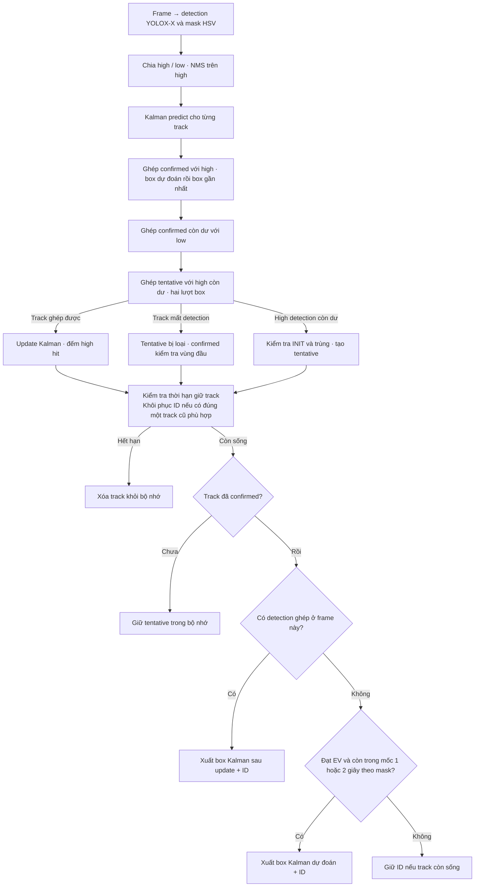

# Method của cấu hình exsort được chọn

Mô tả này theo [cấu hình được chọn](../configs/selected.json). Nguồn code và dependency được ghi trong [lịch sử nguồn](../history/source_provenance.json).



Trong [code xử lý một frame](../exsort/core.py), exsort xử lý track đã ghép, xử lý track mất detection, xét các detection còn dư để tạo track, lọc các track hết hạn, khôi phục ID rồi mới quyết định xuất box.

## Một frame được xử lý như thế nào?

1. **Tách detection theo confidence.** High có score≥DET; low có LOW≤score<DET. NMS riêng của tracker áp dụng lên high. Low không được sinh track mới.
2. **Dự đoán chuyển động.** Kalman của OC-SORT dự đoán box bằng state 7 chiều `[cx,cy,area,ratio,vx,vy,varea]`. Khi ghép được detection sau một khoảng mất dấu, ORU của OC-SORT dùng hai quan sát ở hai đầu khoảng đó để cập nhật lại trạng thái.
3. **Ưu tiên track đã xác nhận.** Ghép high detection với box dự đoán bằng IoU và Hungarian, rồi dùng box quan sát gần nhất để thử ghép phần còn lại. Ghép low detection với track confirmed còn thiếu bằng IoU. Sau đó high còn lại mới được ghép với tentative track. Code kiểm tra ngưỡng IoU sau khi chạy Hungarian.
4. **Track tentative cần đủ high observations.** Sinh track với một high hit; chỉ confirmed khi đủ MIN_HITS. Tentative không nhận low và bị bỏ nếu bị mất một frame, nên ba high observations ở giai đoạn khởi tạo phải liên tiếp. Confirmed có thể được low detection tiếp tục duy trì.
5. **Dùng mask bão hòa khi mất detection.** Với track confirmed chưa ghép được, kiểm tra dải trên cùng của box dự đoán, cao bằng `HEAD_FRACTION × chiều cao box`. Nếu dải này chứa ít nhất một pixel thuộc mask, exsort dùng glare để giải thích lần mất detection ở frame đó.
6. **Tuổi ID và quyền xuất box tách nhau.** Mỗi frame mất detection mà vùng đầu nằm ngoài mask làm tăng `unexplained`. Một detection được ghép đặt counter về 0. Một frame mất detection có vùng đầu chạm mask giữ nguyên counter. Track sống khi `unexplained ≤ MAX_AGE`. Để xuất box dự đoán, IoU giữa box Kalman và box detection đã ghép gần nhất phải đạt `EV`. Tuổi box tính từ lần ghép cuối phải không quá **1 × FPS** khi vùng đầu nằm ngoài mask hoặc **2 × FPS** khi vùng đầu chạm mask ở frame hiện tại.
7. **Sinh track và chống trùng.** Detection high chưa ghép chỉ được birth nếu score≥max(DET,INIT). Track còn quan sát thật có thể veto birth bằng cùng axis gate. Với `LOST_BIRTH=defer`, track đang mất dấu không veto, để người được nhìn thấy lại có cơ hội hình thành candidate. exsort khởi tạo Kalman từ bbox đầu tiên rồi gọi `update` ngay với detection đó để ghi nhận high hit đầu. Lần update này làm giảm độ bất định ban đầu của vị trí.
8. **Khôi phục ID khi có đúng một track cũ phù hợp.** Từ sau `MIN_HITS` frame đầu sequence, khi một track mới vừa đủ số high detection để được xác nhận, exsort so box của nó với các track đã xác nhận đang mất dấu và còn trong bộ nhớ. Nếu đúng một track cũ thỏa axis gate, track mới nhận ID đó và thay thế track cũ. Các trường hợp còn lại giữ ID mới.
9. **Xuất box.** Sau khi ghép detection, exsort xuất box từ trạng thái Kalman đã cập nhật (`MEASURE=posterior`). Khi mất detection, exsort xuất box dự đoán nếu thỏa các điều kiện ở bước 6. Việc xuất box bắt đầu từ frame xác nhận track.

## Axis gate tái sử dụng IOU

Với box detection `b` và box tham chiếu `r`, dùng:

```text
rho = (1-IOU)/(1+IOU)
distance(center(b),center(r)) < rho * max(width(b),height(b),width(r),height(r),1)
```

Thử cả prediction và observation cuối của track. Quan hệ rho xuất phát từ độ dịch một trục của hai box bằng kích thước tại ngưỡng IoU; việc dùng khoảng cách Euclidean và cạnh dài là một heuristic mở rộng. Không diễn giải nó là xác suất thống kê hoặc kiểm định Bayes đã hiệu chuẩn.

## Các tham số đã được thử trên val

Vòng SMAC đầu tìm tám tham số trong miền dưới đây. Giá trị bản chọn được ghi theo cấu hình cuối sau các vòng thử tiếp theo. `MIN_HITS` đã được đưa vào tìm kiếm và giá trị cuối trùng với giá trị khởi đầu là 3. [Miền tìm kiếm SMAC](../configs/search_broad.json) · [Lịch sử tuning](TUNING.md#lịch-sử-trước-bản-public)

| Tham số | Miền SMAC vòng đầu | Giá trị bản chọn | Vai trò |
|---|---:|---:|---|
| `DET` | 0,18–0,45 | 0,25214 | Ngưỡng confidence cho nhóm high |
| `LOW` | 0,05–0,15 | 0,10128 | Ngưỡng confidence thấp nhất được đưa vào association |
| `NMS` | 0,30–0,65 | 0,60224 | Ngưỡng IoU của NMS trên nhóm high trong tracker |
| `IOU` | 0,15–0,50 | 0,30955 | Ngưỡng association và tham số dùng để tính `rho` |
| `MIN_HITS` | 2–5 | 3 | Số high detection liên tiếp để xác nhận track mới |
| `MAX_AGE` | 20–180 frame | 160 frame | Ngân sách giữ track theo số frame miss chưa được mask giải thích |
| `HEAD_FRACTION` | 0,15–0,40 | 0,18433 | Phần chiều cao box tính từ trên xuống để kiểm tra mask |
| `EV` | 0,30–0,80 | 0,72337 | IoU tối thiểu giữa box dự đoán và box quan sát gần nhất để được xuất |

`INIT=0,4` là ngưỡng tạo track riêng, lấy giá trị khởi điểm từ TrackTrack rồi kiểm tra bằng ablation trên val. Các cấu hình lịch sử đã thử dùng chung `DET` hoặc dùng `INIT` riêng ở 0,3, 0,4 và 0,5. Đây là tham số số thứ chín của cấu hình cuối. [Các cấu hình val đã thử](../history/validation_candidates_20261029.json)

## Các thiết lập cố định trong vòng tune tham số số học

- **Kalman và ORU của OC-SORT.** Kế thừa mô hình vận tốc hằng, các ma trận khởi tạo `F`, `H`, `Q`, `R`, `P` và cách nội suy tuyến tính trong ORU. Bản vendored có khác biệt ở cách lưu và khôi phục trạng thái ORU, gồm chuyển tọa độ bbox thành scalar cho NumPy. exsort gọi thêm một lần update sau khi khởi tạo như mô tả ở bước 7. [Khởi tạo Kalman](../exsort/vendor/ocsort/ocsort.py) · [Code ORU](../exsort/vendor/ocsort/kalmanfilter.py)
- **Mask bão hòa.** Resize ảnh về 512 × 512 rồi chuyển sang HSV. Một pixel vào mask nếu đồng thời có `V ≥ 235` và `S ≤ 89`. [Code mask](../exsort/cache.py)
- **Detector và cache.** Dùng YOLOX-X checkpoint epoch 15, input 800 × 1.440 (cao × rộng), confidence floor 0,001, NMS 0,65 và tối đa 100 detection mỗi frame khi tạo cache. `NMS` trong bảng trên là ngưỡng riêng của tracker trên các detection đã có trong cache. [Protocol cache](../README.md#3-tạo-cache-detector-và-mask-một-lần)

Mốc xuất box **1 giây ngoài mask và 2 giây chạm mask** được áp dụng trong `configs/selected.json` qua `COAST_MODE=fps_budget`. FPS lấy theo timeline của ảnh đưa vào tracker.

## Các tình huống đã chạy qua pipeline

Các kiểm tra dưới đây gọi `step()` bằng detection và mask mô phỏng. Bảng ghi ID xuất ra và các ID còn trong bộ nhớ. Các hàng ghi “bản gốc” mô tả `COAST_MODE=budget`, cấu hình trước khi áp mốc theo FPS.

| Tình huống | Kết quả khi chạy |
|---|---|
| Từng detection rời có score 0,08, 0,15 hoặc 0,35 | Cả ba đều không tạo track. 0,08 dưới `LOW`, 0,15 thuộc nhóm low, 0,35 thuộc nhóm high nhưng dưới `INIT`. |
| Hai high detection gần như trùng nhau ở frame đầu, tiếp theo có hai frame high | NMS giữ một detection ở frame đầu. Ba frame lần lượt xuất `∅ → ∅ → ID 1`. |
| Hai high hit rồi chỉ có low detection | Track tentative bị xóa tại frame low. |
| Track đã confirmed nhận low detection score 0,15 | Xuất ID 1 sau cập nhật Kalman. Tuổi kể từ detection cuối về 0 và số high hit vẫn là 3. |
| Box dự đoán trôi khỏi detection quay lại, box quan sát cuối vẫn khớp | Lượt thử lại với box quan sát cuối ghép về ID 1. ORU chạy một lần để cập nhật trạng thái khi có lại detection. |
| High detection còn dư ở gần một track vừa ghép | Axis gate chặn tạo track trùng. ID đang thấy tiếp tục được xuất. |
| Track mới vừa confirmed với một, hai hoặc không có track cũ phù hợp | Một track cũ phù hợp thì dùng lại ID cũ. Hai hoặc không có track cũ phù hợp thì xuất ID mới. |
| Bản gốc có ba frame miss với mask tắt, bật rồi tắt | Bộ đếm miss chưa được giải thích là `1 → 1 → 2`, output là `∅ → ID 1 → ∅`. Detection ghép tiếp theo reset bộ đếm. |
| Mask chạm vùng đầu nhưng box trôi quá ngưỡng EV | Ở IoU 0,818 box được xuất. Ở IoU 0,667 output dừng và ID vẫn trong bộ nhớ. |
| Mất detection 161 frame với mask chạm liên tục, box đứng yên | Bản gốc còn xuất ở tuổi 160. Ở tuổi 161 dừng output và giữ ID. |
| Mất detection 161 frame liên tục với mask trống | Bản gốc dừng output từ frame miss đầu. ID còn ở tuổi 160 và bị xóa ở tuổi 161. |
| Cấu hình 1/2 giây tại 22 FPS, box đứng yên và đạt EV | Mask trống ở tuổi 22 thì còn xuất, tuổi 23 dừng. Mask chạm ở tuổi 24 thì xuất lại. Mask chạm ở tuổi 44 còn xuất, tuổi 45 dừng. Detection ở frame sau vẫn ghép lại ID 1. |

## Rủi ro và đánh đổi

Glare là bằng chứng môi trường dễ có false explanation. Đèn không thuộc người, glare kéo dài trên vùng trống, hoặc đối tượng đi ra khỏi cảnh vẫn có thể tạo prediction FP. EV và emission budget hạn chế điều này nhưng không loại hết. Axis gate có thể veto nhầm birth cạnh người khác; recovery duy nhất vẫn có thể nối sai khi một old track không phải cùng người nhưng hình học tình cờ phù hợp.

Không ReID giúp bỏ chi phí appearance inference và tránh feature bị glare/domain shift, nhưng làm ID recovery phụ thuộc hình học. MAX_AGE đo theo frame, nên thời lượng thực thay đổi theo FPS; không tự chuyển thành giây mà vẫn coi cấu hình tương đương. Các cảnh đông, giao cắt hoặc camera di chuyển mạnh cần đánh giá riêng.

## API Python tối thiểu

```python
import json
import numpy as np
from exsort.api import create_tracker
from exsort.cache import saturation

config = json.load(open("configs/selected.json", encoding="utf8"))
# Dùng FPS thật của sequence. Ví dụ bên dưới là sequence 22 FPS.
tracker = create_tracker(config, fps=22)
# Một config/process; cấu hình nội bộ dùng module globals giống snapshot gốc.
# image_bgr: ảnh OpenCV HxWx3 uint8; dets: normalized cx,cy,w,h + score.
mask = np.unpackbits(saturation(image_bgr)).reshape(512, 512).astype(bool)
H, W = image_bgr.shape[:2]
dets = [{"box": np.array([.5, .5, .1, .4], np.float32), "conf": .9}]
tracks = tracker.step(dets, W, H, frame_idx=1, sat=mask)
for track in tracks:
    print(track.id, track.out_box())
```

Tham số frame_idx giữ theo API nghiên cứu; caller phải gọi mỗi frame đúng thứ tự và không bỏ qua frame không có detection. Mỗi sequence tạo tracker mới. Dùng process riêng khi thử nhiều cấu hình, không tạo hai tracker khác config rồi chạy xen kẽ trong cùng process.
