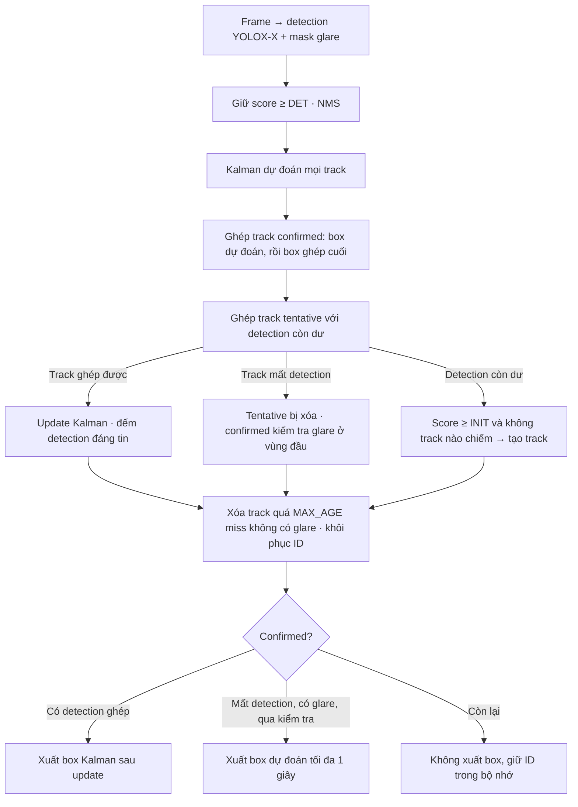

# Phương pháp Ex-Sort

Tài liệu này mô tả đúng [code tracker](../exsort/tracker.py) với [cấu hình cuối](../configs/final.json).



## Detection đáng tin

Một detection là **đáng tin** khi score ≥ `INIT` (0,6). Detection có score từ `DET` (0,1) đến dưới `INIT` vẫn được ghép để giữ track, nhưng không tạo track mới và không được tính khi xác nhận track.

## Xử lý một frame

1. **Lọc detection.** Giữ detection có score ≥ `DET`, rồi chạy NMS tham lam theo score với ngưỡng IoU `NMS`.
2. **Dự đoán.** Mỗi track tiến một bước Kalman của OC-SORT. State 7 chiều `[cx, cy, area, ratio, vx, vy, varea]`. Khi track ghép lại được sau một khoảng mất detection, ORU của OC-SORT cập nhật lại state bằng quỹ đạo nội suy.
3. **Ghép track confirmed.** Hungarian trên IoU, chỉ nhận cặp có IoU ≥ `IOU`. Vòng 1 so với box dự đoán. Vòng 2 so các track và detection còn dư với box detection ghép cuối của track.
4. **Ghép track tentative.** Cùng hai vòng như trên, với detection còn lại.
5. **Track mất detection.**
   - Track tentative bị xóa ngay. Vì vậy `MIN_HITS` (3) detection đáng tin để xác nhận phải đến khi track không bị mất frame nào.
   - Với track confirmed, kiểm tra dải trên cùng của box dự đoán, cao `HEAD_FRACTION` (25%) chiều cao box. Nếu dải này có ít nhất một pixel của mask glare, lần mất này **được glare giải thích**.
   - Lần mất không được giải thích làm tăng bộ đếm `unexplained`. Lần mất có glare giữ nguyên bộ đếm. Ghép được detection thì bộ đếm về 0.
   - Track bị xóa khi `unexplained` > `MAX_AGE` (120 frame).
6. **Tạo track.** Detection còn dư chỉ tạo track khi đáng tin và không bị track nào chiếm:
   - track vừa ghép ở frame này chiếm detection nếu IoM (giao chia diện tích box nhỏ hơn) với box ghép cuối ≥ `IOU`;
   - track đang mất detection chiếm detection nếu tâm detection gần box dự đoán hoặc box ghép cuối của track (axis gate bên dưới).
7. **Khôi phục ID.** Sau `MIN_HITS` frame đầu sequence, xét track mới có đúng `MIN_HITS` lần ghép, vừa ghép ở frame này và chưa từng được xác nhận. Nếu đúng một track đã xác nhận đang mất detection chiếm nó theo axis gate, track mới nhận ID đó và track cũ bị bỏ. Có hai ứng viên trở lên thì giữ ID mới.
8. **Xuất box.** Chỉ track confirmed được xuất:
   - Có detection ghép ở frame này: xuất box Kalman sau update.
   - Mất detection: chỉ xuất box dự đoán khi đồng thời (a) frame hiện tại có glare ở vùng đầu, (b) thời gian từ lần ghép cuối ≤ `GLARE_COAST_SECONDS` × FPS, (c) IoU giữa box dự đoán và box ghép cuối ≥ `EV` (0,9), (d) trung bình score các detection đã ghép của track ≥ `INIT`. Không có glare thì không xuất box dự đoán.
   - Track có detection đáng tin cuối cùng cũ hơn `MAX_AGE` frame không xuất box, nhưng vẫn ở trong bộ nhớ. Nó xuất lại khi có detection đáng tin.

## Axis gate

Với box `b` và box tham chiếu `r`:

```text
rho = (1 - IOU) / (1 + IOU)
khoảng cách tâm(b, r) < rho × max(rộng b, cao b, rộng r, cao r, 1)
```

`rho` là độ dịch theo một trục mà tại đó hai box cùng kích thước rơi khỏi ngưỡng ghép `IOU`. Gate này dùng lại `IOU`, không thêm tham số.

## Tham số

| Tham số | Giá trị | Vai trò |
|---|---:|---|
| `DET` | 0,1 | Score thấp nhất được đưa vào ghép |
| `INIT` | 0,6 | Score của detection đáng tin |
| `NMS` | 0,6 | Ngưỡng IoU của NMS |
| `IOU` | 0,3 | Ngưỡng ghép; cũng dùng cho IoM khi tạo track và axis gate |
| `MIN_HITS` | 3 | Số detection đáng tin để xác nhận track |
| `MAX_AGE` | 120 frame | Giới hạn miss không có glare; giới hạn tuổi detection đáng tin để xuất box |
| `HEAD_FRACTION` | 0,25 | Phần trên của box được kiểm tra glare |
| `EV` | 0,9 | IoU tối thiểu giữa box dự đoán và box ghép cuối để xuất box dự đoán |
| `GLARE_COAST_SECONDS` | 1,0 s | Thời gian tối đa xuất box dự đoán khi có glare |

Nguồn gốc các giá trị: [TUNING.md](TUNING.md).

## Thành phần cố định

- **Kalman và ORU của OC-SORT**, giữ nguyên trong [exsort/vendor/ocsort](../exsort/vendor/ocsort). Track mới được khởi tạo từ box đầu tiên rồi update ngay với detection đó.
- **Mask glare.** Resize ảnh về 512 × 512 (INTER_AREA), chuyển HSV, pixel thuộc mask khi `V ≥ 235` và `S ≤ 89`. [Code mask](../exsort/cache.py)
- **Detector cache.** YOLOX-X, input 800 × 1440 (cao × rộng), score floor 0,001, NMS 0,65, tối đa 100 detection mỗi frame. `NMS` trong bảng trên là NMS riêng của tracker trên các detection đã cache.

## API Python

```python
import json
import numpy as np
from exsort.api import create_tracker
from exsort.cache import saturation

config = json.load(open("configs/final.json", encoding="utf8"))
tracker = create_tracker(config, fps=25)   # FPS thật của sequence; mỗi sequence một tracker mới

# Mỗi frame, theo thứ tự, kể cả frame không có detection:
H, W = image_bgr.shape[:2]
mask = np.unpackbits(saturation(image_bgr)).reshape(512, 512).astype(bool)
dets = [{"box": np.array([cx, cy, w, h], np.float32), "conf": score}]   # box chuẩn hóa theo W, H
for track in tracker.step(dets, W, H, sat=mask):
    print(track.id, track.out_box())   # out_box: cx, cy, w, h chuẩn hóa
```

## Giới hạn

- Glare có thể giải thích nhầm: đèn không thuộc người, hoặc người đã rời cảnh khi glare vẫn còn. `EV`, giới hạn 1 giây và luật score trung bình giảm rủi ro này nhưng không loại hết.
- Không dùng ReID nên khôi phục ID chỉ dựa vào hình học. Một track cũ của người khác vẫn có thể được nối nhầm nếu vị trí tình cờ khớp.
- `MAX_AGE` tính theo frame, nên thời lượng thực phụ thuộc FPS.
